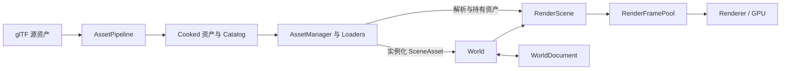

# World 设计入门：从一个模型到一帧画面

阅读时间约 **15–20 分钟**。本文面向熟悉 C++ 和基本渲染流程的读者，用 Renderer 中的 Bistro 串起当前 World 的设计。阅读后，应当能判断：一份数据属于哪里、谁拥有它、何时可以修改，以及保存场景后如何恢复。

本文讲当前已实现的链路；完整目标和后续规划见 [World Foundation](WorldFoundation.md)。代码片段围绕设计边界展开，完整应用入口在 [Renderer.h](../Examples/Renderer/Source/Renderer.h)。

## 1. 同一把椅子的三种数据

假设 Bistro 中有十把使用相同模型的椅子。我们需要保存一次顶点、索引和材质，同时允许每把椅子有自己的位置、名称和编辑身份。提交绘制后，即使用户继续移动椅子，GPU 正在读取的数据也必须保持有效。

因此，这个系统分别维护三类数据：

| 数据 | 椅子的例子 | 负责的模块 |
| --- | --- | --- |
| 可共享的资产 | 椅子网格、木头材质、纹理 | Asset 系统 |
| 世界中的实体 | 第三把椅子的名称、位置、父节点、材质覆盖 | World |
| 一帧的渲染输入 | 本帧矩阵、draw、GPU 表及其资源引用 | RenderScene 与 RenderFramePool |

修改第三把椅子的位置，只改变它在 World 中的组件。其他九把继续共享原来的 MeshAsset。生成渲染输入时，系统再把这个修改传播到对应实例和帧数据中。

这个划分决定了后面的接口：资产负责共享与加载，World 负责实体和编辑，帧快照负责一次 GPU 提交使用的数据。



现在的源格式导入实现是 glTF。Runtime 读取的是烘焙后的资产；将来接入 USD，主要工作位于导入和语义映射层，World 与帧生命周期的基本分工可以继续沿用。

## 2. 用身份找到同一个东西

椅子的网格文件可以移动，应用可以关闭再打开，ECS 里的槽位也可以被回收。我们需要把“长期身份”和“本次运行中的位置”分开。

最先记住四个类型：

| 类型 | 表达什么 | 是否保存到场景 |
| --- | --- | --- |
| `AssetID` | 某份 Mesh、Material、Texture 或 SceneAsset | 保存资产引用时使用 |
| `Guid` | 世界中的某个可编辑实体 | 保存 |
| `AssetHandle` | Asset Manager 中的一次运行时资产记录 | 不保存 |
| `Entity` | 某个 World 中的运行时实体 | 不保存 |

十把椅子可以拥有相同的 Mesh `AssetID`，但每把都有不同的 `Guid`。重新打开场景时，这些 `Guid` 保持不变；对应的 `Entity` 则需要在新 World 中重新查找。

`AssetID` 和 `Guid` 都采用 128 位值，但它们属于不同的语义域。前者由导入过程及随源文件维护的身份文件（sidecar）维护，后者标识实体的摆放和编辑结果。源文件移动时需要一起维护身份元数据；单纯对文件内容取 hash 无法代替这份身份。

内容指纹用于判断是否需要重新烘焙，AssetID 用于识别同一份资产。同一份资产重新烘焙后，内容指纹可以变化，AssetID 仍应保持稳定。

运行时句柄还包含 generation（代数）。一个槽位先后装过两份资产时，旧句柄不能误认后来者。Entity 也有类似的失效防护，但只在创建它的 World 中使用。`entity.isValid()` 仅表示非空，实际存活要询问 `world.isAlive(entity)`；AssetHandle 非空也不代表资产已经 Ready。

稍后看到的 RenderObjectID 和 GpuMeshID 等类型，属于渲染期身份。它们帮助定位和校验运行时记录，也不进入 World 文件。

## 3. World 封装实体生命周期，组件保存数据

World 是一个管理对象的 C++ 类，内部借助 Flecs 存储组件和执行查询。公共接口隐藏 Flecs 类型，业务代码通过 `createPersistentEntity`、`setComponent`、`setParent` 等方法修改世界。

组件保持为简单数据。例如 `LocalTransform` 保存平移、旋转和缩放，`MeshRenderer` 保存 Mesh 的 AssetID 及材质覆盖。它们可以被编辑、序列化和提取，不需要各自继承一个带虚函数的实体基类。

这让 OOP 和 ECS 各有位置：World、Asset Manager、RenderScene 封装状态与生命周期；大量实体的属性按组件存储。实体上有什么能力，由它实际拥有的组件决定。

下面的片段可放入一个返回 `bool` 的示例函数。需要包含 `Scene/World.h` 和 `Scene/SceneComponents.h`：

```cpp
hz::TypeRegistry types;
if (!types.registerBuiltins())
    return false;
hz::World world(types);

const hz::Entity group = world.createPersistentEntity();
const hz::Entity chair = world.createPersistentEntity();
if (!group.isValid() || !chair.isValid())
    return false;

const hz::LocalTransform groupLocal = { .translation = Vector3(10, 0, 0) };
const hz::LocalTransform chairLocal = { .translation = Vector3(2, 0, 0) };
const bool created = world.setComponent(group, hz::SceneTypes::localTransform, &groupLocal) &&
                     world.setComponent(chair, hz::SceneTypes::localTransform, &chairLocal) &&
                     world.setParent(chair, group, false);
if (!created)
    return false;
world.updateTransforms();
```

这里椅子的世界坐标 X 为 12。`setComponent` 会复制输入值，局部变量离开作用域后，组件仍由 World 管理。对于 MeshRenderer 内拥有的数组，注册的生命周期操作负责复制和销毁。

`createPersistentEntity()` 会分配可持久化的 Guid；`createEntity()` 可用于临时运行时实体。WorldDocument 只捕获带持久身份的实体。需要保存的实体，其父实体也应当具有 Guid。

`getComponent()` 返回只读借用视图。结构变化可能搬迁组件存储，不能把返回指针长期保存在 Renderer 或其他缓存中。需要长期定位时保存合适的 ID，需要修改时重新查询或调用 World 的编辑接口。

## 4. 层级维护局部关系，世界矩阵由系统派生

父子关系表达椅子属于哪个分组。椅子的局部变换描述它相对分组的位置，WorldTransform 则是层级求值后的结果：

```text
childWorld = parentWorld × childLocal
```

常见可编辑变换使用 `LocalTransform`，也就是 TRS。对于带 shear 等无法无损表示为 TRS 的数据，系统保留 `LocalMatrix`。两种局部表示互斥；导入矩阵时不会先强行分解，再接受精度损失。

`WorldTransform` 是派生缓存，不进入反射和场景文件。局部数据修改后，通过 `updateTransforms()` 更新结果；正常渲染路径中的 RenderScene 更新也会调用它。层级更新使用迭代遍历，并传播受影响子树的脏标记（dirty），深层树不依赖 C++ 调用栈递归。

重新设置父节点时，需要明确想保留什么。`setParent(chair, group, false)` 保留局部变换，适合按已有局部坐标组装层级。默认的 `keepWorld=true` 则保留当前世界姿态，并重新计算局部矩阵；新父变换无法求逆时返回失败。形成环的父子关系同样会被拒绝。

删除也有两个明确操作：`destroyEntity(parent)` 保留子实体，解除其父关系并保持世界姿态；`destroySubtree(parent)` 删除整棵子树。编辑器可以据此表达“删除分组”和“删除分组及内容”的不同意图。

遍历组件时，立即改变存储结构会影响正在使用的视图。WorldQuery 在遍历期间推迟结构修改，也可以用 `world.defer()` 主动包住一批结构变化。最外层作用域结束时再提交这些操作。

这里的 defer 只推迟结构变化。给已有组件设置新值、修改已有属性仍立即生效；给实体添加一个新组件才等到提交。它不提供回滚或快照隔离。重挂父节点和删除带子节点的实体，应放到 query/defer 作用域之外。

## 5. 加载一份资产，需要三个角色

从磁盘加载 Bistro 时，Asset 系统分为三部分：

**AssetCatalog 保存资产目录。** 它将 AssetID 对应到类型、文件位置和依赖关系。读取 Catalog 只获得元数据，不等于把里面所有网格和纹理都加载进内存。

**AssetManager 管理运行时记录。** `request(id)` 会查找或创建记录，取得一份引用，并安排依赖加载。重复请求同一 ID 可以复用记录；每次取得的引用都需要对应释放。`find(id)` 只查询已有记录，不取得引用。

**AssetLoaders 完成具体工作。** 它负责读取、解码、上传和销毁不同类型的已加载数据（payload）。Asset Manager 通过统一协议推进状态，Mesh、Texture 等 loader 处理各自的数据细节。底层 ResourceLoader 仍可参与 GPU 上传。

一次请求大致经历排队、CPU 加载、等待依赖、GPU 上传，最后到达 Ready 或 Failed。请求返回后，调用方可以通过 `assetManager.update()` 推进加载并查询结果。Renderer 的初始化允许等待场景就绪，普通帧则继续按帧推进。

SceneAsset 依赖节点实际引用的 Mesh，Mesh 继续依赖默认材质，材质再引用纹理。Scene 请求 Ready 时，其必要依赖也已经就绪。多个 Mesh 可以共享同一次底层 geometry 上传；多个实体引用相同 Mesh，也不会各自复制顶点数据。

Mesh 和 Material 当前可以作为同一 SceneAsset 文档中的子资产记录，仍拥有独立 AssetID。它们在文档数组中的位置只是定位信息。材质替换同样使用 Mesh 内稳定的 `SubmeshID`，避免重新导入导致数组重排后把覆盖材质绑到另一块几何上。

加载失败和取消也属于生命周期。最后一份引用在加载中释放后，后台任务可能仍在执行；完成结果需要进入清理路径，相关 slot 在安全清理前不会被拿去承载另一份请求。

## 6. 从 SceneAsset 到 World：复制实体，交接资产引用

SceneAsset 保存一个可实例化的节点模板：名称、父索引、局部变换、Mesh 引用等。调用 `instantiate(world)` 后，World 得到一组独立实体和一个实例根节点。

把同一份 Bistro 模板实例化两次，两组实体会生成不同的 Guid。它们仍引用相同的 Mesh、Material 和 Texture 资产。之后移动第一组的根节点，只影响这组实体的层级结果。

不过，组件中的 AssetID 只是一个值。往 World 写入 MeshRenderer，不会自动产生资源引用；World 也不直接拥有那份 GPUBuffer。

当前由 `WorldAssetBindings` 解析这些资产引用，取得 Mesh 和覆盖后材质的长期引用。RenderScene 拥有这层绑定，因此 Renderer 通常直接创建 RenderScene。绑定状态为 Pending 或 Failed 时，实体不会作为正常可绘制内容提交。

实际初始化顺序需要保留引用的交接。以下省略错误检查，`world` 和 `assetManager` 已经存在，`sceneHandle` 对应的资产已经 Ready：

```cpp
const hz::SceneAsset* asset = assetManager.getScene(sceneHandle);
const hz::Entity root = asset->instantiate(world);
hz::RenderScene scene(world, assetManager);
scene.update();
assetManager.release(sceneHandle);
```

先让 RenderScene 建立长期绑定，再释放 Scene 请求持有的引用。SceneAsset 模板完成实例化后可以卸载；活着的实体仍通过绑定保留所需资源。实例化失败则回滚本次创建的新实体，不留下半个场景。

还有第三段时间需要覆盖：GPU 正在执行旧帧。即使椅子已从 World 删除，绑定在下一次更新释放了长期引用，旧帧使用的资产也必须继续存活。因此资源保护形成三个相接的阶段：

```text
Scene 请求：加载依赖，支持实例化
    → World 绑定：实体存在期间持有所需资产
        → 帧快照：提交后继续保护 GPU 使用中的 payload
```

理解这个交接，就能解释为什么“从 World 删掉实体”与“立即释放 GPU 内存”不是同一个时刻。

## 7. RenderScene 把实体展开为绘制数据

World 的组织方式适合编辑和查询。渲染还需要更明确的数据：哪些实体已就绪、每个实体有多少次实例化、每个 submesh 使用什么材质，以及哪些 GPU 表可以解析这些引用。

RenderScene 从 World 和资产绑定中提取这些结果，当前主要分为三层：

| 层 | 关注的数据 | 椅子的例子 |
| --- | --- | --- |
| RenderObject | Mesh 以及它对应的实例范围 | 一把使用某 Mesh 的椅子 |
| RenderInstance | 变换、包围盒、Guid | 这把椅子的当前与上一提交姿态 |
| RenderDraw | submesh 和材质引用 | 木头、坐垫分别产生 draw |

当前阶段，一个就绪的 MeshRenderer 实体对应一个可渲染实例。若 Mesh 有三个 submesh，它会展开为三个 Draw。十把这样的椅子可共享 Mesh，却分别拥有十份变换和三十个 Draw。

这些记录使用可以复用的稀疏槽位（sparse slot）。删除中间的椅子会留下空洞，其他记录不必全部搬家；复用 slot 时递增 generation。遍历时使用有效项列表（active list），不能把整个底层数组都当作有效实体。

Draw 记录的是强类型 GpuMeshID、GpuMaterialID 及 submesh 引用。GPU 间接表再把这些身份解析到实际数据和资源描述符（descriptor）。资产 ID、GPU ID、descriptor index 各承担不同定位职责；一个 descriptor 数字不能表达整份 Mesh 或场景实体的生命周期。

Camera 和 Light 也从 World 提取。Camera 提供位姿和镜头参数，窗口宽高比与投影矩阵由渲染端决定。Light 提取保存不同光源形状的参数，当前示例实际求值的是 Directional；数据中存在某种光源，不表示相应采样和着色已经全部实现。

## 8. 绘制时取得一份帧快照

RenderScene 本身仍会继续更新。它返回的 Span 是借用视图，下次更新后就不能继续依赖旧视图。GPU 绘制需要更长、更明确的有效期，因此正式提交使用 `RenderFrame`。

RenderFramePool 把场景记录与相匹配的资产表一起捕获，返回一份只能移动、不能复制的 lease。这里的 lease 表示一份有明确归还点的使用权：持有期间，相关资源不会被回收。调用方通过它读取当前帧数据；提交后把它转交给帧池，直到 GPU 完成才允许回收。

配对很关键。例如旧 Draw 的 submesh 索引是基于旧 Mesh 表解释的。渲染时必须同时使用相匹配的 Draw 和资产表，不能随手从 Asset Manager 查询另一时刻的表来拼接。

当前快照保护 Asset Manager 当时整个 Ready payload 集合，并非已经实现了逐可见实体的精细资源筛选。这个选择使初版快照边界清楚，后续可以在不改变 World 组件的前提下继续优化。

Renderer 的实际帧流程如下：

```text
Update：相机输入 → 修改 World 组件 → assetManager.update()
Draw：capture → 提取场景与资产 → 记录 Pass → submit → retire
随后：fence 完成 → collect → 允许复用 backing 和释放引用
```

当前 `RenderPasses::update()` 只更新各 Pass；真正的 RenderScene 提取发生在 `frames.capture()` 内部。capture 先收集已完成的提交，找到可用的帧存储（backing），再更新 World 变换、资产绑定和提取记录，补齐本帧数据。

记录完命令后，Renderer 中最关键的一行是：

```cpp
frames.retire(std::move(snapshot), context.submit(commands, &backbuffer));
```

`submit` 产生可追踪的提交句柄；`retire` 接过 lease，记录该帧实际使用的数据。调用方在交接后结束对快照及其借用视图的使用。

快照的不可变性是使用契约，不代表任意线程都能同时修改 World 或捕获帧。目前这些状态按所属线程上的明确阶段顺序操作，每个池同时只允许一个 CPU lease。帧池提供了所有权边界，通用多线程调度仍属于后续工作。

## 9. previous 表示上次实际提交的状态

运动矢量需要比较当前帧与上一帧的位置。这里的“上一帧”必须对应实际提交，而不能简单等同于上一次逻辑 Update。

假设上次已经提交的椅子位置是 A：

| 接下来的操作 | 当前捕获的姿态 | previous |
| --- | --- | --- |
| 连续更新到 B、C，捕获 C | C | A |
| 丢弃这份快照，再更新并捕获 D | D | A |
| 提交 C 并 retire，之后捕获 D | D | C |

表中后两行是两种不同的后续选择。丢弃快照、窗口暂停期间只 Update，都会保留上次实际提交的历史。首次出现、slot 复用或主动 `resetHistory` 时，使用 previous=current，避免产生无意义的大幅运动。

历史推进发生在提交后的 `retire` 调用中，GPU fence 完成负责另一件事：允许释放资源和重用 backing。推进历史时使用这份快照保存的 current，而不是再读取已经可能变动的 World。

例如捕获 C 后，World 又被修改为 D，本次提交的仍然是 C。若把 D 写进 previous，下一帧的运动矢量就会使用一份从未绘制过的姿态。

World 自身也有变换历史接口，当前渲染路径由帧快照管理提交历史。应用不应在每次逻辑 Update 后额外调用 `commitTransforms()` 来代替这个流程。相机 cut 和窗口尺寸变化也需要明确重置渲染历史。

## 10. 三份 backing，各自补齐自己的变化

CPU 与 GPU 可以同时处理不同帧。帧池默认轮换三份 backing，避免 CPU 写入 GPU 仍在读取的那份 Buffer。只按帧号轮换还不够：每份 backing 都要知道自己同步到了哪个版本号（revision）。

假设 backing B 上次同步到 revision 7。revision 8 移动了椅子，revision 9 只修改灯光。现在再次使用 B 时，若只复制 revision 9 的 dirty 数据，B 里的椅子还停在旧位置。

因此，RenderScene 的变更日志（journal）累积记录变更范围。B 需要同时补齐 revision 8 和 9。每份 backing 按自己的 revision 追赶，而不是让全部 Buffer 共享一个“本帧已更新”的标记。

删除和 slot 复用也要同步：清空的数据、active list、实例索引都可能发生变化。只补矩阵，会让旧 Draw 或旧 active 项继续出现在某份轮转 Buffer 中。

journal 容量有限。当 backing 太久没有使用，所需历史已经超出保留范围时，系统回退到完整同步。首次使用和容量扩展也可以完整同步，普通场景修改则只写受影响的范围。资产 Ready 集合变化时，资产表当前采用完整更新。

现实现使用 CPU_TO_GPU 映射内存写入这些表。预热后的稳定帧和普通变换修改避免分配；初始化、扩容或资产集合改变仍允许分配。这是明确的热路径约束，不需要把每个罕见变化都塞进固定大小的预分配池。

如果三份 backing 都仍在 GPU 使用中，`capture()` 返回无效，示例跳过本次绘制；它不会在这里等待某个 fence。这只描述帧池捕获行为，整个绘制流程中的命令列表获取或呈现仍可能有等待。

## 11. 保存世界，保留编辑意图

我们希望关闭应用后，第三把椅子仍叫原来的名字，位于原来的分组，并继续引用指定的网格和坐垫材质。

WorldDocument 因此保存 Guid、父 Guid、名称、组件类型和版本，以及声明为可序列化的属性。AssetID 和稳定 SubmeshID 也随组件一起保存。Entity、AssetHandle、GPU 实体、descriptor 和派生的 WorldTransform 则在加载后重新建立。

这些属性来自显式注册的 reflection metadata。TypeRegistry 描述类型、属性、生命周期及序列化行为，World 在构造时接入已经注册的类型，因此 metadata 必须比 World 活得更久。TypeID 和 PropertyID 在代码中保持稳定。当前文件用 TypeID 定位组件、用属性名读写字段；属性重命名需要提升组件版本，并显式迁移旧字段名。

同一份 metadata 还可以供后续 Inspector 使用。当前反射接口已经支持属性和数组编辑，但它不会自动生成完整编辑器，也不会把所有业务规则都推导出来；例如属性范围是编辑提示，不会自动把数值 clamp 进范围。

接着第 3 节的示例，可以保存并重新加载椅子。另需包含 `Scene/WorldDocument.h`、`Core/IUniquePtr.h`，并假设文件系统已初始化、`RD_OTHER_FILES` 已映射到可写目录：

```cpp
const hz::Guid chairID = world.getEntityGuid(chair);
hz::WorldDocument document;
if (!document.capture(world) || !document.save(RD_OTHER_FILES, "demo.world.json"))
    return false;

hz::WorldDocument loaded;
if (!loaded.load(RD_OTHER_FILES, "demo.world.json"))
    return false;
hz::unique_ptr<hz::World> restored;
if (!loaded.instantiate(types, restored))
    return false;
return restored->isAlive(restored->getEntity(chairID));
```

这里通过持久的 chairID 找回新 World 中的 Entity。恢复实体后，还需要建立新的 RenderScene 和资产绑定，才能重新绘制；加载 WorldDocument 不会顺便加载全部 GPU 资产。

加载先构建 staging World，完成组件、引用和层级验证后才替换目标。失败时，原目标保留。若要替换一个已有 World，必须先处理引用旧 World 的查询、defer 作用域、RenderScene 和未完成帧，不能让它们继续指向已销毁的实体。

文档支持显式的相邻版本迁移。`parse` 可以保留未知组件的原始 JSON，便于文档读写不破坏内容；真正 `instantiate` 时，无法识别的组件或缺少迁移步骤会导致失败。保留文本与成功恢复可运行世界，是两个分别校验的能力。

## 12. 退出时，按依赖关系结束生命周期

RAII 让每个拥有者负责释放自己的资源，也要求调用方按正确顺序销毁拥有者。帧池借用 RenderScene 和 RenderContext，RenderScene 借用 World 和 Asset Manager；这些依赖需要比使用它们的实体活得更久。

正常关闭时，先停止生成新帧，结束未提交的 lease。等待或由帧池 drain 已提交工作后，销毁帧池和渲染 Pass，再销毁 RenderScene，释放长期资产绑定。随后销毁 World 和相关 metadata，shutdown Asset Manager，清理还在加载或上传的任务，最后结束 loaders、catalog 和 RenderContext。

实际 Renderer 在退出前先 `waitIdle()`，让这条关闭路径更直接。运行时删除单个实体仍依靠引用与 fence 退休，不需要为每次实体删除等待整个 GPU 空闲。

这也说明 World 这一层的边界：它知道“哪个实体引用什么资产”；绑定层知道“这些引用现在是否可用”；帧池知道“哪次提交还在使用它们”。各自只处理自己能够判断的结束条件。

目前这条链路已跑通 Bistro 的加载、实例化、编辑、保存、卸载、重载和渲染。USD 导入、在线 hot reload、完整 Editor、GPU culling 和更多光源的求值仍是后续能力。现有边界为它们提供了接入位置，不等同于这些功能已经完成。

## 接下来读哪些代码

可以按下面的顺序追踪一次完整流程。先读调用方，再深入需要理解的边界：

| 入口 | 建议关注的内容 |
| --- | --- |
| [Renderer.h](../Examples/Renderer/Source/Renderer.h) | initSceneAsset、Update、Exit：组装系统和引用交接 |
| [World.h](../Source/Runtime/Scene/Public/Scene/World.h) 与 [SceneComponents.h](../Source/Runtime/Scene/Public/Scene/SceneComponents.h) | 实体、组件、层级及持久身份 |
| [WorldAssetBindings.h](../Source/Runtime/Scene/Public/Scene/WorldAssetBindings.h) | 从 AssetID 到持有运行时引用 |
| [RenderScene.h](../Source/Runtime/Scene/Public/Scene/RenderScene.h) | 提取记录、active list 和变更范围 |
| [RenderFrame.h](../Source/Runtime/Scene/Public/Scene/RenderFrame.h) 与 [RenderPasses.cpp](../Examples/Renderer/Source/RenderPasses.cpp) | capture、submit、retire 的完整交接 |
| [WorldDocument.h](../Source/Runtime/Scene/Public/Scene/WorldDocument.h) | 持久化、验证和恢复的边界 |

阅读时可以用三个场景检查自己的理解：移动一把椅子，哪些数据需要更新；删除椅子后旧帧仍在执行，谁继续持有资源；重新打开 World，哪些 ID 保持不变，哪些句柄需要重新取得。能够沿代码回答这些问题，就已经掌握了这套设计的主线。
